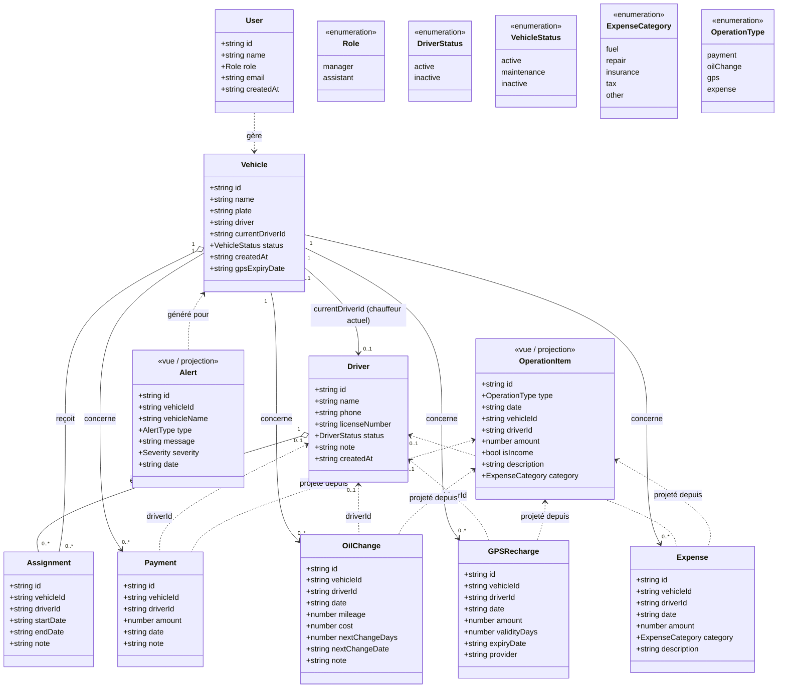
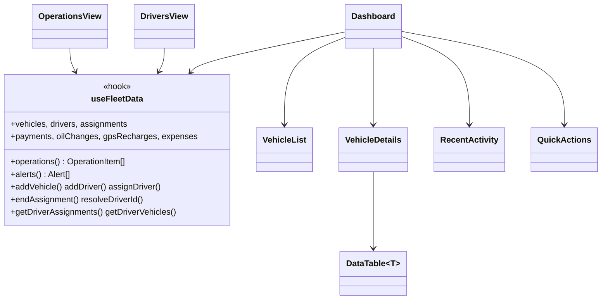

# FleetManager - Draft du projet & architecture des classes

Application de gestion de flotte (véhicules, chauffeurs, opérations financières et
maintenance) construite avec **Next.js (App Router)** + **React** + **TypeScript** +
**Tailwind CSS**. La persistance se fait côté navigateur via **localStorage** (aucun backend).

---

## 1. Vue d'ensemble (draft fonctionnel)

L'application permet à un gérant de flotte de :

- **Gérer des véhicules** : création, statut (actif / maintenance / inactif), suppression.
- **Gérer des chauffeurs** (entité dédiée) : coordonnées, permis, statut.
- **Suivre les affectations** chauffeur ↔ véhicule dans le temps (historique daté).
- **Enregistrer des opérations** de 4 types :
  - `Payment` (versement, = recette)
  - `OilChange` (vidange, = charge)
  - `GPSRecharge` (recharge GPS, = charge)
  - `Expense` (dépense libre catégorisée, = charge)
- **Analyser** : tableau de bord (KPIs, alertes), activité récente, et une **vue Opérations**
  transversale avec filtres par **période**, **chauffeur**, **véhicule** et **type d'opération**,
  plus export CSV.

### Écrans principaux

| Écran | Composant | Rôle |
|-------|-----------|------|
| Tableau de bord | `Dashboard` | KPIs, liste véhicules, détails, activité récente |
| Opérations | `OperationsView` | Vue transversale filtrable + export |
| Chauffeurs | `DriversView` | CRUD chauffeurs + affectations + historique |

Toutes les listes sont **paginées** : véhicules (6/page), chauffeurs (8/page),
activité récente (8/page), opérations (12/page) et les tableaux de données (`DataTable`, 10/page).

---

## 2. Architecture technique (couches)

```
┌─────────────────────────────────────────────────────────────┐
│  Couche Présentation (components/*.tsx)                       │
│  Dashboard · OperationsView · DriversView · VehicleList ·    │
│  VehicleDetails · QuickActions · RecentActivity · DataTable  │
├─────────────────────────────────────────────────────────────┤
│  Couche État / Logique métier (hooks/use-fleet-data.ts)      │
│  useFleetData() : agrège les entités, calcule alertes,       │
│  opérations unifiées, KPIs, résolution du chauffeur actif    │
├─────────────────────────────────────────────────────────────┤
│  Couche Accès aux données (lib/store.ts)                     │
│  CRUD + assignDriver / endAssignment / migration             │
├─────────────────────────────────────────────────────────────┤
│  Couche Modèle (lib/types.ts)                                │
│  User · Driver · Vehicle · Assignment · Payment · OilChange  │
│  GPSRecharge · Expense · OperationItem · Alert               │
├─────────────────────────────────────────────────────────────┤
│  Persistance : localStorage (clés fleet_*)                   │
└─────────────────────────────────────────────────────────────┘
```

---

## 3. Diagramme de classes (UML)

Représentation des entités du domaine, de leurs attributs et de leurs relations.
Les entités sont des `interface` TypeScript (modèle de données anémique) ; la logique
est portée par le store et le hook.



### Notes sur les relations

- **Vehicle ↔ Driver via Assignment** : relation many-to-many historisée. Une `Assignment`
  sans `endDate` = affectation **en cours**. `Vehicle.currentDriverId` dénormalise le chauffeur
  actif pour l'affichage rapide.
- **Chauffeur d'une opération** : chaque opération porte un `driverId` optionnel figé au moment
  de la saisie. Si absent, le hook le résout via l'historique d'affectations à la date de l'opération
  (`resolveDriverId`).
- **OperationItem** et **Alert** ne sont **pas** stockés : ce sont des projections calculées à la
  volée par `useFleetData` (respectivement pour la vue Opérations et les alertes du dashboard).

---

## 4. Composants clés (couche présentation)



---

## 5. Clés de persistance (localStorage)

| Clé | Contenu |
|-----|---------|
| `fleet_users` | `User[]` |
| `fleet_current_user` | `User` courant |
| `fleet_drivers` | `Driver[]` |
| `fleet_vehicles` | `Vehicle[]` |
| `fleet_assignments` | `Assignment[]` |
| `fleet_payments` | `Payment[]` |
| `fleet_oil_changes` | `OilChange[]` |
| `fleet_gps_recharges` | `GPSRecharge[]` |
| `fleet_expenses` | `Expense[]` |

> Le diagramme UML est écrit en syntaxe **Mermaid** : il se visualise directement sur GitHub,
> dans VS Code (extension Mermaid) ou sur https://mermaid.live pour l'exporter en image.
